# Servora Intelligence

> **Intelligent, Multi-Tenant AI Operations Platform for High-Growth E-Commerce & Customer Support**

Servora Intelligence transforms customer operations into an enterprise-grade, multilingual intelligence engine. Designed from the ground up for high-scale e-commerce, it combines an operational customer support inbox with Retrieval-Augmented Generation (RAG), external logistics integration (CalQuick), human-approved financial workflows, intelligent multi-signal routing, and automated 8-dimension quality assurance.

---

## Architecture Overview

```mermaid
graph TD
    User([Customer / Agent / Manager]) -->|HTTPS / Next.js 14| WebApp[Next.js 14 Modern Frontend :3000]
    WebApp -->|REST API / JWT Auth| CoreAPI[NestJS Core API Engine :4000]

    subgraph "Core Data & Infrastructure Layer"
        CoreAPI -->|pgvector / RLS| DB[(PostgreSQL 16 pgvector)]
        CoreAPI -->|Distributed Cache / Queues| Cache[(Redis 7)]
        CoreAPI -->|Knowledge & Media Objects| S3[(MinIO Object Storage)]
    end

    subgraph "Multilingual & AI Intelligence Core"
        CoreAPI --> Language[Language Detector EN / BN / Banglish / Mixed]
        CoreAPI --> Intent[Intent, Sentiment & Urgency Classifier]
        CoreAPI --> VectorStore[Hybrid Lexical BM25 + Vector Search]
        CoreAPI --> Citations[Automated Citation Verification]
        CoreAPI --> ProviderRouter[Config-Driven LLM Router: Gemini / OpenAI / Mock]
    end

    subgraph "Governance & Operational Safety"
        CoreAPI --> Budget[AI Spend Limits & Token Safety Ceilings]
        CoreAPI --> PII[PII Redaction BD & International]
        CoreAPI --> Guardrails[Prompt Injection Boundary Isolation]
        CoreAPI --> Approvals[Human Approval State Machine & Idempotency]
        CoreAPI --> Audit[Tamper-Evident Immutable Audit Log]
    end

    subgraph "Operations & External Integrations"
        CoreAPI --> Routing[Intelligent Multi-Signal Routing Engine]
        CoreAPI --> CalQuick[CalQuick E-Commerce Logistics Adapter]
        CoreAPI --> QA[8-Dimension Automated QA & Coaching]
        CoreAPI --> Analytics[Real-Event Analytics Dashboard]
    end
```



---

## Key Capabilities & Highlights

1. **Enterprise Multi-Tenancy & Security (Phase 2)**:
   - Complete tenant isolation at API, database, vector search, and background job layers.
   - Role-Based Access Control (`SUPPORT_AGENT`, `SUPPORT_MANAGER`, `TENANT_ADMIN`).
   - AES-256-GCM authenticated credential encryption and bcrypt password hashing.
   - Structured JSON audit logging with correlation IDs on all sensitive actions.

2. **Core Operational Inbox (Phase 2B)**:
   - Full 3-pane interactive workspace (`/inbox`) with conversation threads, status toggles (`open`, `pending`, `resolved`, `closed`), assignment/reassignment, priority tags, private internal notes, and search.

3. **Multilingual AI Intelligence (Phase 3)**:
   - High-precision language detection supporting standard English, Bengali script (`bn`), and Romanized Bengali (`bn-Latn` / Banglish).
   - Real-time intent, sentiment (including customer frustration detection), and urgency classification (1 to 5).
   - Config-driven LLM provider abstraction supporting Google Gemini as primary, OpenAI as fallback, and a deterministic offline Mock provider.

4. **Tenant-Isolated Knowledge Base & RAG (Phase 4)**:
   - Semantic text chunking, cross-lingual embedding alignment, and hybrid search (`pgvector` cosine similarity + lexical matching).
   - Real document source citations and automated citation validation that rejects hallucinated references.
   - Interactive knowledge management and semantic retrieval tester (`/knowledge`).

5. **CalQuick E-Commerce Integration (Phase 5)**:
   - Typed adapter interface (`CalQuickAdapter`) with a deterministic mock sandbox engine simulating realistic order and courier logistics data.
   - Zero-downtime swap to live credentials when upstream endpoints are supplied.

6. **Controlled Tool Calling Registry (Phase 6)**:
   - Strict JSON schema validation, execution timeouts, role permissions, and per-conversation tool call budgets for `lookup_order`, `check_courier_status`, `search_customer_policy`, and `get_customer_history`.

7. **Human-Approved Actions & Idempotency (Phase 7)**:
   - Zero autonomous execution of financial actions by AI.
   - `prepare_refund_proposal`: produces typed draft proposals with policy eligibility checks in `PENDING` state.
   - Mandatory human manager approval (`SUPPORT_MANAGER` or `TENANT_ADMIN`).
   - Cryptographic `x-idempotency-key` prevents double refunds across network retries.

8. **Intelligent Multi-Signal Routing (Phase 8)**:
   - Scores agents on skills, language proficiencies, current workload, CSAT, and customer urgency.
   - Shadow Mode runs by default, producing structured explainability rationales alongside existing routing.
   - Active Mode auto-assigns tickets above confidence thresholds while enforcing hard workload capacity limits.

9. **Automated Quality Assurance & Coaching (Phase 9)**:
   - Evaluates 100% of resolved conversations across 8 dimensions (Accuracy, Policy Compliance, Resolution Quality, Empathy, Clarity, Citations, Tools, Safety).
   - Automatic warning flags for safety breaches, policy violations, or low empathy.
   - Actionable coaching notes with positive reinforcement, improvements, and suggested phrasing.
   - Manager review and agent dispute workflows.

10. **Real-Event Analytics Dashboard (Phase 10)**:
    - Real metrics computed from stored database records, QA rubrics, and CI golden evaluations with sample sizes (`n=...`).
    - Operational KPIs, AI reliability metrics, cost intelligence, and budget consumption tracking.
    - Side-by-side Model Benchmark comparison matrix (Gemini 2.5 Flash vs OpenAI GPT-4o-mini vs Local Mock) over 20 master evaluation scenarios.
    - CSV and JSON metric exports (`/analytics`).

11. **Release Hardening & Resilience (Phase 11)**:
    - Proven failover under LLM outages, Redis disruptions, and database errors.
    - Budget exhaustion degradation: AI assistance pauses safely while human inbox operations continue normally.

---

## Quickstart & Local Setup

### 1. Boot Required Infrastructure
```bash
docker compose up -d
```
Spins up PostgreSQL 16 (pgvector), Redis 7, and MinIO S3 object storage.

### 2. Install Dependencies
```bash
npm install
```

### 3. Run Quality & Type Verification
```bash
npm run typecheck
npm run test:backend
npm run build:frontend
```

### 4. Start Local Development
```bash
npm run dev
```
- **Web App**: `http://localhost:3000`
- **Inbox Workspace**: `http://localhost:3000/inbox`
- **Knowledge Base**: `http://localhost:3000/knowledge`
- **Analytics & Evals**: `http://localhost:3000/analytics`
- **Backend API**: `http://localhost:4000`
- **Health Check**: `http://localhost:4000/api/health`

---

## Test Suites & Coverage

Servora Intelligence includes 14 comprehensive test suites with 105 automated unit and integration tests covering all critical boundaries:

| Test Suite | File | Focus Area |
|---|---|---|
| Multi-Tenancy & Security | `test/tenant-isolation.spec.ts` | Row-Level Security, crypto encryption, RBAC guards |
| Inbox Core | `test/inbox-core.spec.ts` | Threads, messages, notes, assignment, search |
| Multilingual & AI Core | `test/golden-eval.spec.ts` | 20 master evaluation cases, EN/BN/Banglish, safety |
| Knowledge Intelligence (RAG) | `test/rag-knowledge.spec.ts` | Semantic chunking, hybrid retrieval, citation validator |
| CalQuick Integration | `test/calquick.spec.ts` | Typed client, mock sandbox, order/courier queries |
| Tool Registry | `test/tool-registry.spec.ts` | JSON schema validation, budget limits, execution history |
| Approvals & Idempotency | `test/approvals.spec.ts` | Proposal preparation, manager approval, idempotency |
| Intelligent Routing | `test/routing.spec.ts` | Multi-signal scoring, shadow mode, workload caps |
| Automated QA & Coaching | `test/qa.spec.ts` | 8-dimension evaluation, coaching notes, dispute flows |
| Analytics & Evaluation | `test/analytics.spec.ts` | Real-event metrics, empty states, CSV/JSON exports |
| Reliability & Security | `test/reliability.spec.ts` | Failure injection, provider failover, pen-testing |
| Environment Validator | `test/env.validation.spec.ts` | Startup configuration validation |
| Feature Flags | `test/feature-flags.spec.ts` | Per-tenant feature toggling |
| System Health | `test/health.spec.ts` | Diagnostic health probes |

Execute all tests:
```bash
npm run test:backend
```

---

## Documentation Index

- [Implementation Progress Matrix (`docs/servora/PROGRESS.md`)](docs/servora/PROGRESS.md)
- [Architecture Decision Records (`docs/servora/DECISIONS.md`)](docs/servora/DECISIONS.md)
- [Operations & Deployment Runbook (`docs/servora/OPERATIONS.md`)](docs/servora/OPERATIONS.md)

---

## License

Proprietary & Confidential. All rights reserved. Servora Intelligence.
