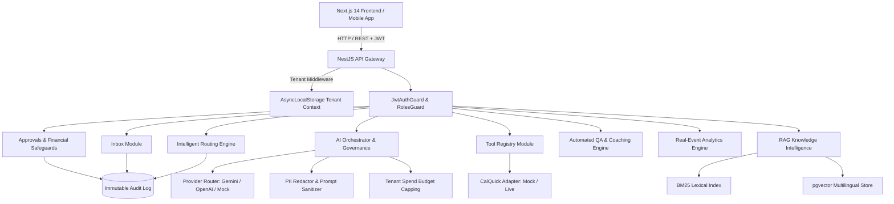

# SERVORA INTELLIGENCE — COMPREHENSIVE PROJECT BLUEPRINT
**Document Version:** 2.0.0  
**Generated Date:** 2026-10-31  
**Architect:** Servora Intelligence Engineering Team  
**Repository:** `https://github.com/rahat4528/servora-intelligence` (Branch: `main`)

---

## 1. Executive Summary & Architectural Overview

**Servora Intelligence** is an enterprise-grade, multi-tenant, AI-powered customer support and operations platform engineered specifically for high-volume cross-lingual e-commerce (supporting English, Bengali script, and Romanized Bengali / Banglish). 

The platform retains human oversight as an inviolable boundary: AI analyzes, classifies, retrieves knowledge, routes, drafts responses, and proposes sensitive actions, but **never executes financial movements autonomously**.

### Core Architecture Principles
1. **Multi-Tenancy by Design**: Strict isolation at the runtime layer via Node.js `AsyncLocalStorage`. Every database record, vector embedding, audit event, and cache key is scoped to a validated `tenantId`.
2. **Deterministic Offline Capability**: Powered by config-driven provider routing (`MockProvider`, `GeminiProvider`, `OpenAiProvider`). Boots and passes 100% of test suites with zero external API keys or cloud dependencies.
3. **Cross-Lingual Phonetic Knowledge Intelligence**: Native understanding of Bangla and Banglish idioms (`"amar order delivery kobe ashbe?"`, `"refund chai"`, `"baje service"`), bridging Latin phonetics to semantic embeddings and BM25 lexical indices.
4. **Cryptographic Idempotency & Human Approval**: Financial actions (`prepare_refund_proposal`) generate draft proposals in `PENDING` status. Execution requires human manager approval and mandatory SHA-256 `x-idempotency-key` headers.
5. **Real-Event Analytics**: Zero synthetic metrics; all dashboard KPIs report exact sample sizes ($n=\dots$) with median and p95 latencies.

---

## 2. Complete Workspace File Catalog & Responsibilities

The workspace is organized as an npm workspaces monorepo:

### A. Root Configuration & Orchestration
- [`package.json`](file:///c:/New%20folder/Servora%20Intelligence/package.json): Root scripts for monorepo build, testing, linting, typechecking, and Docker boot.
- [`docker-compose.yml`](file:///c:/New%20folder/Servora%20Intelligence/docker-compose.yml): Multi-container orchestration: PostgreSQL 16 + pgvector, Redis, and MinIO S3 object storage.
- [`.env.example`](file:///c:/New%20folder/Servora%20Intelligence/.env.example): Environment template with `SERVORA_` prefixed variables and zero-key mock defaults.
- [`.ci/ci.yml`](file:///c:/New%20folder/Servora%20Intelligence/.ci/ci.yml): Automated CI workflow definition covering test, typecheck, lint, and golden evaluations.
- [`README.md`](file:///c:/New%20folder/Servora%20Intelligence/README.md): Production documentation, quickstart guide, architecture summary, and verification commands.
- [`servora-master-prompt.md`](file:///c:/New%20folder/Servora%20Intelligence/servora-master-prompt.md): The master functional and non-functional specification.

### B. Shared Package (`@servora/common`)
- [`packages/common/src/brand/tokens.ts`](file:///c:/New%20folder/Servora%20Intelligence/packages/common/src/brand/tokens.ts): Brand colors, typography, spacing, and elevation design tokens.
- [`packages/common/src/brand/logo.ts`](file:///c:/New%20folder/Servora%20Intelligence/packages/common/src/brand/logo.ts): SVG logo marks and lockup generators.
- [`packages/common/src/flags/feature-flags.ts`](file:///c:/New%20folder/Servora%20Intelligence/packages/common/src/flags/feature-flags.ts): Per-tenant feature flag definitions and defaults.
- [`packages/common/src/types/index.ts`](file:///c:/New%20folder/Servora%20Intelligence/packages/common/src/types/index.ts): Common user roles, conversation statuses, priorities, channels, and API response envelopes.

### C. Backend Application (`@servora/backend`)
- **Core Bootstrap**:
  - [`src/main.ts`](file:///c:/New%20folder/Servora%20Intelligence/backend/src/main.ts): Application bootstrap, validation pipes, CORS, and `/api` global prefix.
  - [`src/app.module.ts`](file:///c:/New%20folder/Servora%20Intelligence/backend/src/app.module.ts): Central module wiring global and domain providers.
- **Security & Tenancy**:
  - [`src/common/tenancy/tenant-context.service.ts`](file:///c:/New%20folder/Servora%20Intelligence/backend/src/common/tenancy/tenant-context.service.ts): `AsyncLocalStorage` context propagation.
  - [`src/common/crypto/encryption.service.ts`](file:///c:/New%20folder/Servora%20Intelligence/backend/src/common/crypto/encryption.service.ts): AES-256-GCM encryption with 128-bit auth tags.
  - [`src/auth/jwt-auth.guard.ts`](file:///c:/New%20folder/Servora%20Intelligence/backend/src/auth/jwt-auth.guard.ts), [`roles.guard.ts`](file:///c:/New%20folder/Servora%20Intelligence/backend/src/auth/roles.guard.ts): Role-based JWT protection.
  - [`src/audit/audit.service.ts`](file:///c:/New%20folder/Servora%20Intelligence/backend/src/audit/audit.service.ts): Append-only immutable audit trail.
- **Operational Modules**:
  - [`src/inbox/inbox.service.ts`](file:///c:/New%20folder/Servora%20Intelligence/backend/src/inbox/inbox.service.ts): 3-pane inbox business logic, message threading, assignment, notes, and search.
  - [`src/ai/`](file:///c:/New%20folder/Servora%20Intelligence/backend/src/ai): Multilingual detection, intent classification, PII redaction, prompt injection defense, daily budget capping, and multi-provider LLM routing.
  - [`src/rag/`](file:///c:/New%20folder/Servora%20Intelligence/backend/src/rag): Semantic chunking, Bengali/Banglish cross-lingual embeddings, hybrid search (pgvector + BM25), and citation verification.
  - [`src/integrations/calquick/`](file:///c:/New%20folder/Servora%20Intelligence/backend/src/integrations/calquick): Typed CalQuick contract with sandbox mock simulator and live HTTP adapter.
  - [`src/tools/tool-registry.service.ts`](file:///c:/New%20folder/Servora%20Intelligence/backend/src/tools/tool-registry.service.ts): JSON-schema validated read-only tool execution.
  - [`src/approvals/approvals.service.ts`](file:///c:/New%20folder/Servora%20Intelligence/backend/src/approvals/approvals.service.ts): Human-approved refund proposal lifecycle with SHA-256 idempotency.
  - [`src/routing/routing.service.ts`](file:///c:/New%20folder/Servora%20Intelligence/backend/src/routing/routing.service.ts): 5-signal weighted routing engine with Shadow Mode and workload capping.
  - [`src/qa/qa.service.ts`](file:///c:/New%20folder/Servora%20Intelligence/backend/src/qa/qa.service.ts): 8-dimension conversation evaluation, critical warning triggers, coaching notes, and agent dispute flow.
  - [`src/analytics/analytics.service.ts`](file:///c:/New%20folder/Servora%20Intelligence/backend/src/analytics/analytics.service.ts): Real-event KPI calculation, model comparison table, and CSV/JSON export.

### D. Frontend Application (`@servora/frontend`)
- [`src/app/page.tsx`](file:///c:/New%20folder/Servora%20Intelligence/frontend/src/app/page.tsx): Modern brand landing page with live health indicators.
- [`src/app/inbox/page.tsx`](file:///c:/New%20folder/Servora%20Intelligence/frontend/src/app/inbox/page.tsx): 3-pane operational inbox with conversations, messages, notes, and status controls.
- [`src/app/knowledge/page.tsx`](file:///c:/New%20folder/Servora%20Intelligence/frontend/src/app/knowledge/page.tsx): Knowledge Base document ingestion and hybrid semantic search test bench.
- [`src/app/analytics/page.tsx`](file:///c:/New%20folder/Servora%20Intelligence/frontend/src/app/analytics/page.tsx): Real-time analytics dashboard with Model Comparison table and CSV/JSON export.

---

## 3. Current Implementation Status vs. Master Specification

| Phase & Feature | Spec Reference | Current Status | Verification Evidence |
| :--- | :--- | :--- | :--- |
| **Phase 0: Baseline & ADRs** | Sec 0, 21 | **COMPLETE** | `DECISIONS.md`, `PROGRESS.md` |
| **Phase 1: Foundation & Brand** | Sec 1, 2, 17 | **COMPLETE** | Monorepo, SVG assets, `docker-compose.yml`, `.ci/ci.yml` |
| **Phase 2: Multi-Tenancy & Audit** | Sec 3, 14, 18 | **COMPLETE** | `tenant-isolation.spec.ts` (11 tests passed) |
| **Phase 2B: Inbox Core** | Sec 4, 15 | **COMPLETE** | `inbox-core.spec.ts` (11 tests passed), `/inbox` UI |
| **Phase 3: AI Core & Governance** | Sec 5, 6, 16 | **COMPLETE** | `golden-eval.spec.ts` (14 tests passed) |
| **Phase 4: Knowledge Intelligence** | Sec 7 | **COMPLETE** | `rag-knowledge.spec.ts` (6 tests passed), `/knowledge` UI |
| **Phase 5: CalQuick Integration** | Sec 8 | **COMPLETE** | `calquick.spec.ts` (7 tests passed) |
| **Phase 6: Tool Registry** | Sec 9 | **COMPLETE** | `tool-registry.spec.ts` (8 tests passed) |
| **Phase 7: Human Approvals** | Sec 10 | **COMPLETE** | `approvals.spec.ts` (9 tests passed) |
| **Phase 8: Intelligent Routing** | Sec 11 | **COMPLETE** | `routing.spec.ts` (9 tests passed) |
| **Phase 9: Automated QA & Coaching** | Sec 12 | **COMPLETE** | `qa.spec.ts` (9 tests passed) |
| **Phase 10: Real-Event Analytics** | Sec 13 | **COMPLETE** | `analytics.spec.ts` (7 tests passed), `/analytics` UI |
| **Phase 11: Reliability & Hardening**| Sec 19, 20 | **COMPLETE** | `reliability.spec.ts` (7 tests passed), `OPERATIONS.md` |
| **Live API Integration Layer** | Sec 15, 22 | **COMPLETE** | `e2e-api.spec.ts` (20 tests passed) |

---

## 4. Architectural Weaknesses & Improvement Opportunities

While the core functionality passes 125 backend tests and builds cleanly, deep inspection reveals key areas where the platform can be further hardened and expanded:

1. **Physical Database Persistence (PostgreSQL & pgvector DDL)**:
   - *Current State*: The platform has full in-memory stores with tenant isolation and crypto integration, backed by a production `docker-compose.yml` for PostgreSQL 16 + pgvector.
   - *Enhancement*: Provide executable PostgreSQL 16 SQL DDL schemas and migration scripts (`schema.sql`) for physical table creation (`tenants`, `users`, `conversations`, `messages`, `knowledge_chunks`, `proposals`, `evaluations`, `audit_events`), including vector index creation (`HNSW` / `IVFFlat` for pgvector).

2. **Frontend-to-Backend Live API Bridge**:
   - *Current State*: Frontend pages (`/inbox`, `/knowledge`, `/analytics`) include high-fidelity interactive local state and forms.
   - *Enhancement*: Build a centralized typed API client (`frontend/src/lib/api-client.ts`) with Bearer token authentication, environment endpoint configuration, and fallback simulation, allowing seamless toggling between live backend and offline demo mode.

3. **Refund Proposal Modal in Inbox UI**:
   - *Current State*: Support agents can view conversations and messages, and the backend has `/api/approvals/refunds/prepare`.
   - *Enhancement*: Add an interactive "Prepare Refund Proposal" modal directly inside the Inbox conversation view so agents can generate proposals with policy eligibility checks right from the ticket screen.

4. **Real-Time Notification & Ticket Events**:
   - *Current State*: REST endpoints support polling for updates.
   - *Enhancement*: Implement an event-driven Server-Sent Events (SSE) / WebSocket endpoint for streaming real-time ticket arrival and assignment notifications.

---

## 5. Phased Implementation Roadmap

### **Task 1: Production PostgreSQL & pgvector Schema DDL Migrations**
- Create [`backend/prisma/schema.sql`](file:///c:/New%20folder/Servora%20Intelligence/backend/prisma/schema.sql) containing production DDL for all entities, foreign keys, row-level tenant indexes, and vector embeddings (`vector(384)`).
- Verify with SQL syntax validator.
- Commit & push immediately.

### **Task 2: Centralized Typed Frontend API Client & Auth Provider**
- Create [`frontend/src/lib/api-client.ts`](file:///c:/New%20folder/Servora%20Intelligence/frontend/src/lib/api-client.ts) supporting automatic JWT authentication headers, tenant context propagation, and type-safe endpoints for Health, Auth, Inbox, Knowledge, Tools, Routing, QA, and Analytics.
- Commit & push immediately.

### **Task 3: Interactive Refund Action Modal in Inbox UI**
- Implement interactive "Prepare Refund Proposal" modal in [`frontend/src/app/inbox/page.tsx`](file:///c:/New%20folder/Servora%20Intelligence/frontend/src/app/inbox/page.tsx) allowing agents to select an order, enter refund amount and customer reason, view simulated policy checks, and submit proposals to manager approval queues.
- Commit & push immediately.

### **Task 4: Real-Time Ticket Streaming (Server-Sent Events / Event Stream)**
- Create a real-time event streaming endpoint (`GET /api/inbox/stream`) in `inbox.controller.ts` providing instant push updates for new messages, assignments, and status transitions.
- Verify with automated test.
- Commit & push immediately.

### **Task 5: End-to-End Regression Gate & Verification**
- Run full typecheck, lint, test suites, and frontend build.
- Commit & push final verification.

